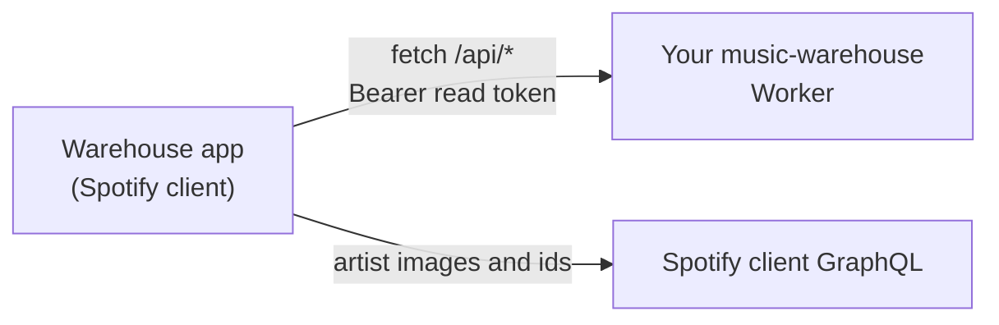

<div align="center">
<h1>music-warehouse-spicetify</h1>
<p><strong>Your music-warehouse listening stats, inside the Spotify desktop client.</strong></p>
<p>
<a href="LICENSE"></a>

<a href="https://spicetify.app"></a>
<a href="https://github.com/rcnsh/music-warehouse#clients"></a>
</p>
<p><a href="#what-it-shows">What it shows</a> · <a href="#quick-start">Quick start</a> · <a href="#setup">Setup</a> · <a href="#troubleshooting">Troubleshooting</a> · <a href="#related-projects">Related projects</a></p>
</div>

A [Spicetify](https://spicetify.app) custom app that adds a **Warehouse** page
to the Spotify desktop client. It shows your top songs and artists, full play
history, Wrapped for any range and more, read from your own
[music-warehouse](https://github.com/rcnsh/music-warehouse) rather than from
Spotify, so it covers your whole history and not just Spotify's last 50 plays.

> [!NOTE]
> This app needs your own [music-warehouse](https://github.com/rcnsh/music-warehouse)
> deployment to read from. If you don't have one yet, start with its
> [quick start](https://github.com/rcnsh/music-warehouse#quick-start).

## What it shows

| Tab | From |
|---|---|
| **Overview**: on repeat (with a 14-day sparkline), jump back in, top songs and artists for 4 weeks, 6 months, a year or all time, and a listening clock with your streak | `/api/stats/on-repeat`, `/api/home`, `/api/top-tracks`, `/api/top-artists`, `/api/stats/rhythm` |
| **History**: every play, newest first, searchable, with each one's play number or "first play" | `/api/plays` |
| **On this day**: what you played on a date in earlier years | `/api/on-this-day` |
| **Albums**: most-played albums, all time and per year | `/api/stats/albums` |
| **Over time**: top artists and songs per year or quarter | `/api/stats/top-over-time` |
| **Wrapped**: any range the warehouse has computed | `/api/wrapped/ranges`, `/api/wrapped` |
| **Concerts**: upcoming gigs for the artists you play most | `/api/concerts` |

Every song and artist opens a page of its own, with totals, plays by month,
top songs and recent plays (`/api/track`, `/api/artist`, `/api/plays`). Hover
a row for a play button; artist pages link to Spotify's own.

Dates are read in the client's own timezone, which is sent to the routes that
take a `tz`.

## How it works



The app only calls the warehouse's `/api/*` routes, never Spotify's Web API,
so Spotify's rate limits and endpoint removals don't affect it. Requests are
plain `fetch` calls with your token as a bearer header, sent from the client's
origin, `https://xpui.app.spotify.com`; that is why the warehouse has to allow
that origin for CORS. A stat the warehouse is still computing answers `503`;
the app waits for its `Retry-After` (at most 30 seconds) and tries once more.

It is plain JavaScript against `Spicetify.React`, with no build step:
`index.js` (shell, API, routing), `components.js` and `pages.js`, concatenated
by Spicetify as listed in `manifest.json`.

The warehouse has no artist images, and artists known only from the export
have no Spotify id (`name:…`). The app fills both in from the client's own
GraphQL, which the Spotify client itself uses. For a placeholder it searches by
name and takes only an exact match, so an artist with a common name stays
unlinked rather than opening the wrong page. Results, misses included, are
cached in local storage (`warehouse:artists`).

## Requirements

- A deployed [music-warehouse](https://github.com/rcnsh/music-warehouse#quick-start),
  and the Spotify account that owns it (to sign in for a token).
- The Spotify desktop client with [Spicetify](https://spicetify.app/docs/getting-started)
  installed and applied.
- `git` and `bash` for `install.sh` (macOS or Linux). On Windows, follow the
  [manual install](#manual-install) instead.

## Quick start

1. Add `https://xpui.app.spotify.com` to your warehouse's `CORS_ORIGINS`
   ([details](#1-allow-the-spotify-client-in-cors)).
2. Install the app:

   ```bash
   git clone https://github.com/rcnsh/music-warehouse-spicetify
   cd music-warehouse-spicetify
   ./install.sh
   ```

3. Open **Warehouse** in the client's top bar, enter your warehouse URL, sign
   in with Spotify for a read token, paste it in and save.

## Setup

### 1. Allow the Spotify client in CORS

The app runs on the client's origin, `https://xpui.app.spotify.com`, so the
warehouse must allow it for CORS. Add it to the warehouse's
[`CORS_ORIGINS`](https://github.com/rcnsh/music-warehouse#configuration)
secret (comma-separated) alongside any other origins you use. From your
music-warehouse checkout:

```bash
npx wrangler secret put CORS_ORIGINS   # e.g. https://xpui.app.spotify.com
```

> [!IMPORTANT]
> `CORS_ORIGINS` is a single value, so setting it replaces what was there.
> Include every origin you use, e.g.
> `https://xpui.app.spotify.com,https://wrapped.example.com`.

If you block tokenless requests with a WAF rule, it must let `OPTIONS` through,
as the warehouse README describes.

### 2. Install Spicetify

Follow Spicetify's [getting started](https://spicetify.app/docs/getting-started)
guide, then run `spicetify backup apply` once so the client is patched. Check
it works with:

```bash
spicetify path userdata
```

which prints the folder that holds `CustomApps/`.

### 3. Install the app

```bash
git clone https://github.com/rcnsh/music-warehouse-spicetify
cd music-warehouse-spicetify
./install.sh
```

`install.sh` does three things:

1. Symlinks this repo's `warehouse/` folder to
   `$(spicetify path userdata)/CustomApps/warehouse`, creating `CustomApps/`
   if needed and replacing any existing link there.
2. Runs `spicetify config custom_apps warehouse` to enable it.
3. Runs `spicetify apply`, which restarts the client with the app in it.

Because it is a symlink rather than a copy, keep the clone where it is: moving
or deleting it breaks the app. To update, `git pull` in the clone and run
`spicetify apply`.

#### Manual install

On Windows, or if you'd rather copy than link: copy `warehouse/` into
`$(spicetify path userdata)/CustomApps/` (keeping the folder name `warehouse`),
then:

```bash
spicetify config custom_apps warehouse
spicetify apply
```

### 4. Connect it to your warehouse

1. Open **Warehouse** in the client's top bar. Until it is set up it opens on
   **Connect your warehouse**.
2. Enter your warehouse URL, e.g. `https://music-warehouse.<you>.workers.dev`.
   A trailing slash is fine.
3. Follow **Sign in with Spotify to get a token**. It opens the warehouse's
   `/auth/login?name=Spicetify` in your browser. Sign in with the Spotify
   account that owns the warehouse (any other is refused) and copy the read
   token from the page. It is shown once.
4. Paste it into **Read token** and press **Save**.

Saving makes one small request (`/api/top-artists?limit=1`), which proves the
URL, CORS and the token at once; nothing is stored unless it succeeds. To
change either later, press **Settings** in the app's header.

Instead of signing in, you can paste a read
[device token](https://github.com/rcnsh/music-warehouse#device-tokens) minted
with `POST /admin/tokens`.

> [!WARNING]
> The URL and token live in the client's local storage (`warehouse:url`,
> `warehouse:token`), which other Spicetify extensions can read. It is a read
> token, so it can't change anything, but revoke it from `/admin/tokens` if you
> stop using the app. Tokens from sign-in expire after 90 days.

## Troubleshooting

| You see | Why, and what to do |
|---|---|
| "Couldn't reach the warehouse. Check the URL, and that it allows https://xpui.app.spotify.com in CORS_ORIGINS." | The request failed before any answer: a wrong URL, or `CORS_ORIGINS` doesn't include the client's origin (or a WAF rule blocks the `OPTIONS` preflight). See [step 1](#1-allow-the-spotify-client-in-cors). |
| "The warehouse refused the token. Paste a new one in Settings." | `401`: the token is wrong, revoked or expired. Sign in again for a new one. |
| Another message or `HTTP <status>` | The warehouse's own error, passed through as-is. |
| Wrapped ranges you can't select | A read token can only open ranges the warehouse has already computed. |
| Concerts is empty | The warehouse only checks for concerts when it has a `TICKETMASTER_API_KEY`; see its [configuration](https://github.com/rcnsh/music-warehouse#configuration). |
| **Warehouse** is missing from the top bar | Spicetify's patch is gone, usually after a Spotify update. See below. |

### After Spotify updates

A Spotify update removes Spicetify's patch. Run `spicetify backup apply` to
patch the new version.

## Uninstalling

```bash
spicetify config custom_apps warehouse-
spicetify apply
rm "$(spicetify path userdata)/CustomApps/warehouse"
```

If you installed by copying rather than with `install.sh`, the last line needs
`rm -r`. Then revoke the token from the warehouse's `/admin/tokens`.

## Development

There is nothing to build. With the app installed by `install.sh`, edit the
files in `warehouse/` and run `spicetify apply` to reload the client with them.

| File | |
|---|---|
| `warehouse/manifest.json` | App name, top-bar icons and the subfiles Spicetify concatenates. |
| `warehouse/index.js` | Settings, the API client, tabs and routing. |
| `warehouse/components.js` | Shared rows, cards, charts and the artist lookup. |
| `warehouse/pages.js` | One component per tab, plus the song and artist pages. |
| `warehouse/style.css` | Styles, all prefixed `mw-`. |

The app's pages live under `/warehouse/<tab>` and
`/warehouse/<artist|track>/<id>` in the client's own router.

## Related projects

| Repo | |
|---|---|
| [music-warehouse](https://github.com/rcnsh/music-warehouse) | The Worker: records your plays and serves the API |
| [music-warehouse-gui](https://github.com/rcnsh/music-warehouse-gui) | Native macOS app for browsing your history |
| [music-warehouse-mcp](https://github.com/rcnsh/music-warehouse-mcp) | MCP server so AI agents can query your history |
| [music-warehouse-spicetify](https://github.com/rcnsh/music-warehouse-spicetify) (this repo) | Stats inside the Spotify desktop client |
| [music-warehouse-wrapped](https://github.com/rcnsh/music-warehouse-wrapped) | Wrapped-style stories for any range, in the browser |

## Licence

[MIT](LICENSE).
